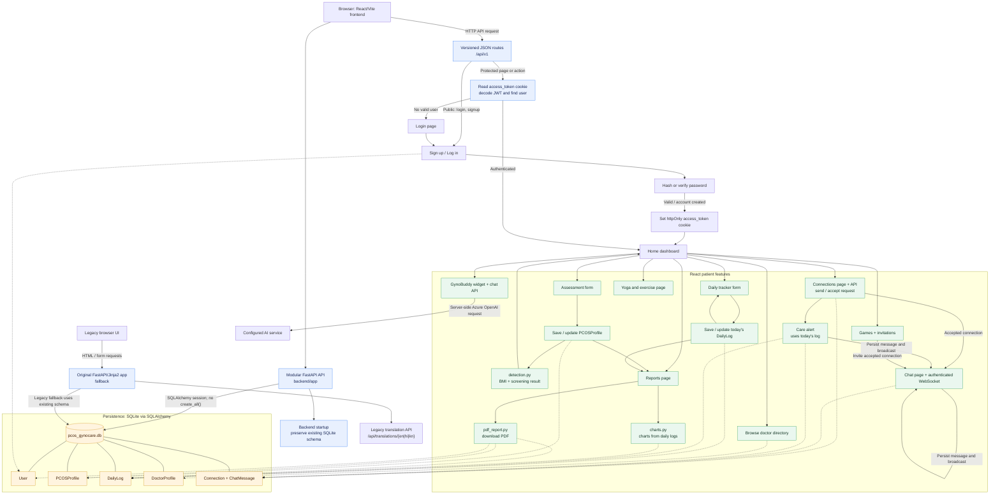

# PCOS GynoCare Project Workflow

This diagram summarizes the current React/FastAPI migration, its main user journeys, and the original app retained as a fallback.

## Main data flow

- **Authentication:** signup hashes the password and creates a user; login verifies the hash. Both issue an `httpOnly` JWT cookie. React sends the cookie to protected API routes.
- **PCOS assessment:** profile form → save `PCOSProfile` → run the screening function → show the result.
- **Daily tracking:** tracker form → save or update the user's log for today. Reports use the saved profile and recent logs for charts and PDF output.
- **Doctor and community features:** doctor accounts can save a `DoctorProfile`; users can browse doctors and create accepted connections. The API checks the connection and frontend origin before establishing WebSocket chat; messages, care alerts, and game invitations are persisted.
- **Other features:** authenticated users can open the chatbot, games, and yoga pages. The language API returns English, Hindi, or Kannada translation data.
